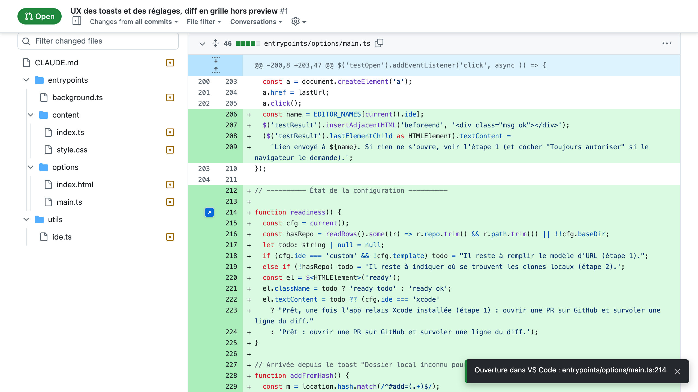
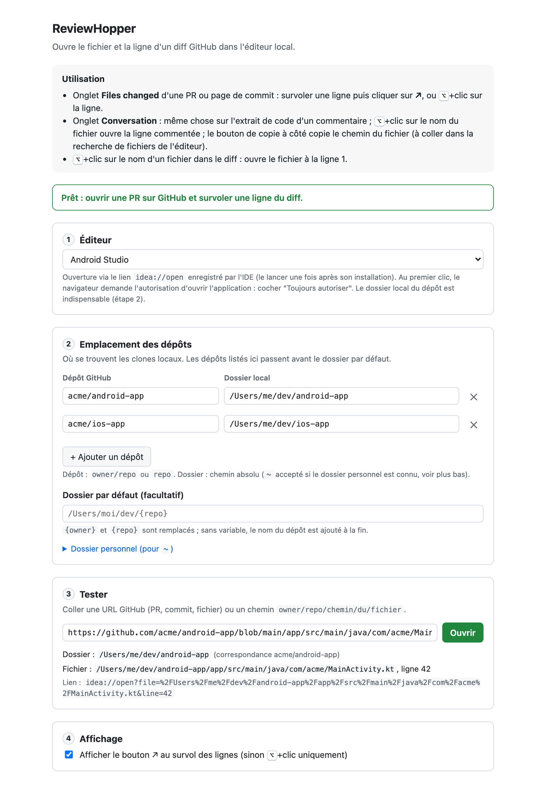

# ReviewHopper

**English** | [Français](README.fr.md)

Browser extension that opens the file and line of a GitHub review in your local editor: PR diffs, commits, review comments.

- **↗** button when hovering a diff line, or Alt+click (⌥+click on Mac).
- Works in the **Files changed** and **Conversation** tabs of a PR, and on commit pages.
- Editors: VS Code, VS Code Insiders, Cursor, Windsurf, VSCodium, Zed, Android Studio, IntelliJ and other JetBrains IDEs, Xcode, or a custom URL template.
- Browsers: Chrome, Edge, Brave, Arc, Dia, Vivaldi, Opera (Chromium family); Firefox, Zen (Firefox family).

<picture>
  <source media="(prefers-color-scheme: dark)" srcset="docs/screenshots/diff-dark.png">
  
</picture>

> The extension's interface (settings page, messages) is currently in French only.

## Contents

- [Quick setup](#quick-setup)
- [Usage](#usage)
- [Settings](#settings)
- [Troubleshooting](#troubleshooting)
- [Build from source](#build-from-source)
- [Releasing](#releasing)
- [License](#license)

## Quick setup

### 1. Download the extension

From the [Releases](https://github.com/jean-melikian/reviewhopper/releases/latest) page, download **one** file, depending on your browser:

| Browser | File |
|---|---|
| Chrome, Edge, Brave, Arc, Dia, Vivaldi, Opera | `reviewhopper-<version>-chrome.zip` |
| Firefox, Zen | `reviewhopper-<version>-firefox.zip` |

The `-sources.zip` file is only used for Mozilla's review.

### 2. Add it to your browser

**Chromium family**

1. Unzip the file (double-click on macOS) and move the resulting folder somewhere it will stay, for example `~/Applications/ReviewHopper`. The browser loads the extension from this folder: if it is deleted or moved, the extension disappears.
2. Open the extensions page: `chrome://extensions` (Chrome, Arc, Dia), `edge://extensions`, `brave://extensions`, `vivaldi://extensions` or `opera://extensions`.
3. Turn on **Developer mode**.
4. Click **Load unpacked** and select the unzipped folder.

**Firefox family**

1. Open `about:debugging#/runtime/this-firefox`.
2. Click **Load Temporary Add-on** and select the downloaded zip, without unzipping it.

Until the extension is published on addons.mozilla.org, Firefox removes it on every restart: load it again the same way.

### 3. Choose your editor

The settings page opens after installation (otherwise, click the extension icon).

1. Choose your editor.
2. Tell the extension where your local clones are (see [Settings](#settings)).

Depending on the editor, there may be one more thing to install:

| Editor | Extra install |
|---|---|
| VS Code, VS Code Insiders, Cursor, Windsurf, VSCodium, Zed | None |
| Android Studio, IntelliJ and other JetBrains IDEs | None: the IDE already handles `idea://` links |
| Xcode | The relay app: [step 4](#4-xcode-only-the-relay-app) |

On the first click, the browser asks permission to open the editor: tick "Always allow".

### 4. Xcode only: the relay app

**Only do this if your editor is Xcode.** Other editors don't need it.

Xcode has no link to open a file at a given line. A small relay app receives the extension's `reviewhopper-xcode://` links and runs `xed --line`. It is built on your machine and only runs while opening the file. Requirements: macOS, Xcode and [Homebrew](https://brew.sh).

```bash
brew install --cask jean-melikian/tap/reviewhopper-xcode
```

- Update: `brew upgrade --cask reviewhopper-xcode`
- Uninstall: `brew uninstall --cask reviewhopper-xcode`
- Without Homebrew, from a clone of this repository: `bash helpers/xcode/install.sh` (uninstall: `bash helpers/xcode/install.sh --uninstall`)

### Updating the extension

- **Chromium**: replace the contents of the step 2 folder with the new zip's contents, click ↻ on the extension card, then reload your GitHub tabs. Keeping the same folder keeps your settings: loading another folder creates a new extension, without settings.
- **Firefox**: load the new zip as in step 2.

## Usage

- **Files changed** tab of a PR, or a commit page: hover a line and click **↗**, or Alt+click (⌥+click on Mac) the line.
- Alt+click a file name: opens the file at line 1.
- **Conversation** tab: same on the code snippet of a review comment. Alt+click the file name opens the commented line.
- Copy button next to the file name (Conversation tab): copies the file path, to paste in your editor's file search (⌘⇧O in Xcode and Android Studio, ⌘P in VS Code).

The opened line is the one in the **new version** of the file (the PR branch). For a deleted line, the extension opens the closest line and says so.

## Settings

Saved automatically.

<details>
<summary>Settings page</summary>

<picture>
  <source media="(prefers-color-scheme: dark)" srcset="docs/screenshots/options-dark.png">
  
</picture>

</details>

1. **Editor** ("Éditeur"): see the table in [step 3](#3-choose-your-editor).
2. **Repository locations** ("Emplacement des dépôts"): one folder per repository (`owner/repo` and its absolute path), and/or a default folder (`/Users/me/dev/{repo}`). `~` is accepted once your home folder is filled in.
3. **Test** ("Tester"): paste a GitHub file URL (`https://github.com/acme/app/blob/main/src/App.kt#L42`) to see the resolved path and open it.
4. **Display** ("Affichage"): ↗ button on hover, or Alt+click only.

## Troubleshooting

Messages are quoted as the extension shows them (in French).

**The ↗ button doesn't show up**
- Reload the GitHub tab: tabs opened before installation are not picked up.
- In the settings, check that "Afficher le bouton ↗ au survol des lignes" is ticked. Alt+click works either way.

**"Aucun dossier local configuré pour owner/repo" (no local folder configured)**
- Add the repository in the settings, or set a default folder.

**Nothing opens on click**
- The browser may have blocked the link: click again and allow it.
- Android Studio / JetBrains: launch the IDE once so it registers `idea://` links.
- Xcode: check that the relay app is installed. This command should print its location; if not, install it ([step 4](#4-xcode-only-the-relay-app)):

  ```bash
  mdfind "kMDItemCFBundleIdentifier == 'com.reviewhopper.xcode'"
  ```

- Use the **Tester** area in the settings to check the folder and the generated link.

**The file opens at the wrong line, or can't be found**
- Your local clone must be on the PR branch: the line is the one in the new version of the file.
- Check the folder mapped to the repository with the **Tester** area in the settings.

**"ReviewHopper a été mis à jour : recharger la page" (updated, reload the page)**
- The extension was reloaded or updated while the tab was open: reload the GitHub tab.

**"Chemin de fichier refusé" (file path rejected)**
- The path read from the page contains `..`, an absolute path or invalid characters: the extension refuses to open it, for security.

**Xcode: "Fichier téléchargé refusé" notification (downloaded file rejected)**
- The relay app rejects downloaded files (quarantined by macOS), so a website can't make Xcode open a malicious file. Work on a repository obtained with `git clone`, not on a downloaded archive.

**IntelliJ / JetBrains: "IDE injoignable" (IDE unreachable)**
- Set the repository's local folder: the extension then uses `idea://` links, no server needed.
- Otherwise, in the IDE: Settings, Tools, Web Browsers and Preview, Built-in Server: port 63342 and "Allow unsigned requests" ticked.

**Firefox: the extension is gone**
- Expected after a restart until it is on addons.mozilla.org: load it again (step 2).

## Build from source

Requirements: Node.js 22 or later.

```bash
git clone https://github.com/jean-melikian/reviewhopper.git
cd reviewhopper
npm install
npm run build          # Chromium: .output/chrome-mv3
npm run build:firefox  # Firefox: .output/firefox-mv3
```

Then load the `.output/chrome-mv3` folder (Chromium) or the `.output/firefox-mv3/manifest.json` file (Firefox) as in [step 2](#2-add-it-to-your-browser).

Other commands:

- `npm run dev` / `npm run dev:firefox`: test browser with live reload.
- `npm run compile`: TypeScript check.
- `npm run screenshots`: regenerate the README screenshots (headless Chrome, after `npm run build`).
- `npm run zip` / `npm run zip:firefox`: store archives (Chrome Web Store, Edge Add-ons, addons.mozilla.org), plus the source archive Mozilla requires.

## Releasing

1. Set the new version in `package.json` (e.g. `1.3.0`) and commit.
2. Push the matching tag:

   ```bash
   git tag v1.3.0 && git push origin v1.3.0
   ```

3. The `Release` workflow checks that the tag matches `package.json`, builds, lints the Firefox build, then creates the GitHub release with the Chrome, Firefox and source zips (plus `SHA256SUMS.txt`).
4. If `helpers/xcode/` changed: copy the `version` and `sha256` shown in the workflow summary into the cask (`jean-melikian/homebrew-tap`, `Casks/reviewhopper-xcode.rb`).

The `CI` workflow checks types and both builds on every push to `main` and every PR. On a PR, it also attaches test builds (Chrome and Firefox, kept 14 days) and comments the link on the PR: download, then load as in [step 2](#2-add-it-to-your-browser).

## License

[MIT](LICENSE)

To report a security issue, see [SECURITY.md](SECURITY.md).
